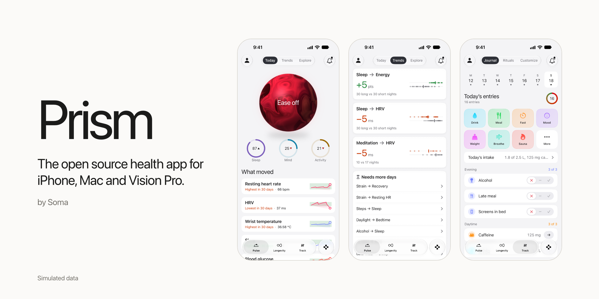
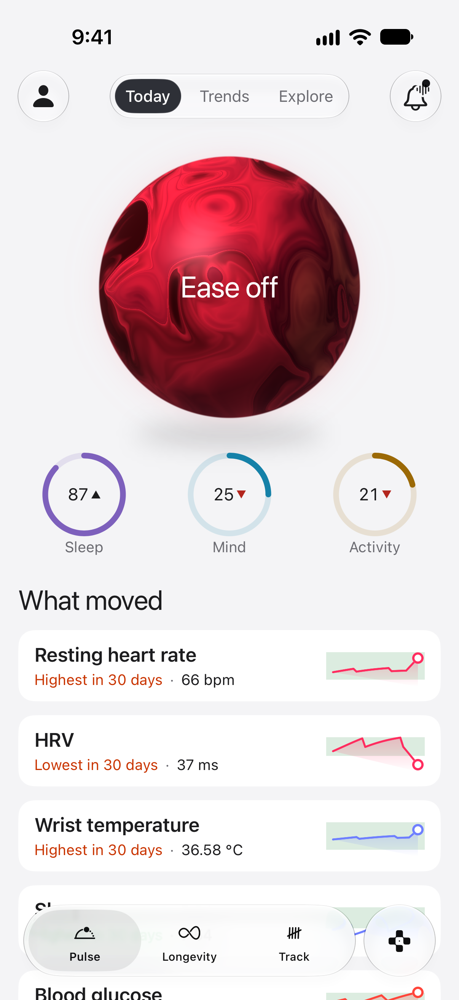
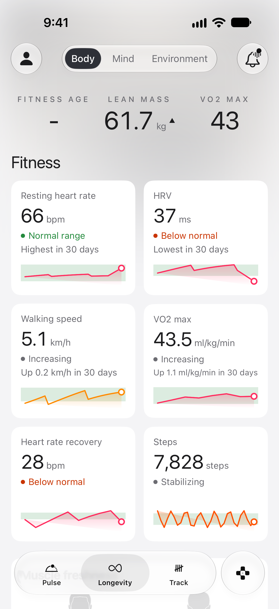
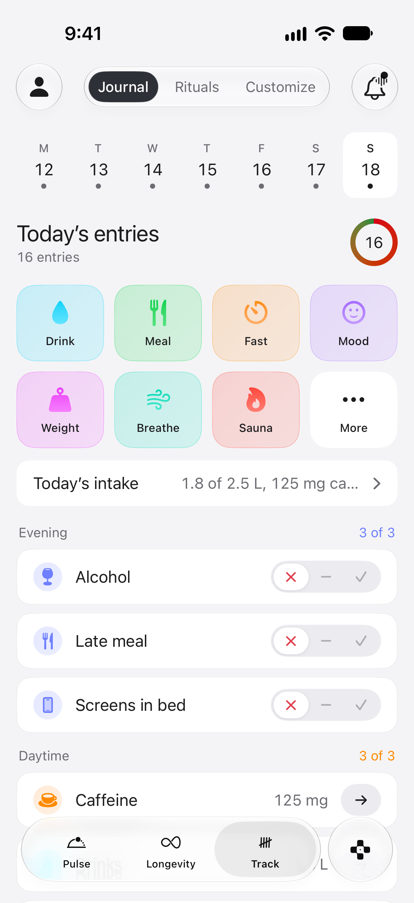
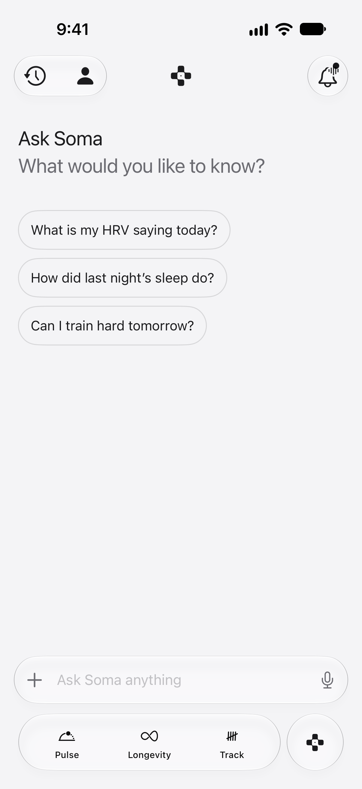
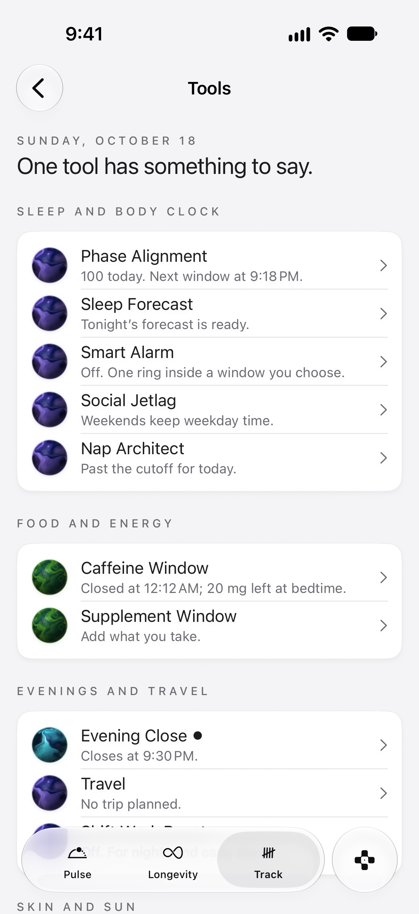
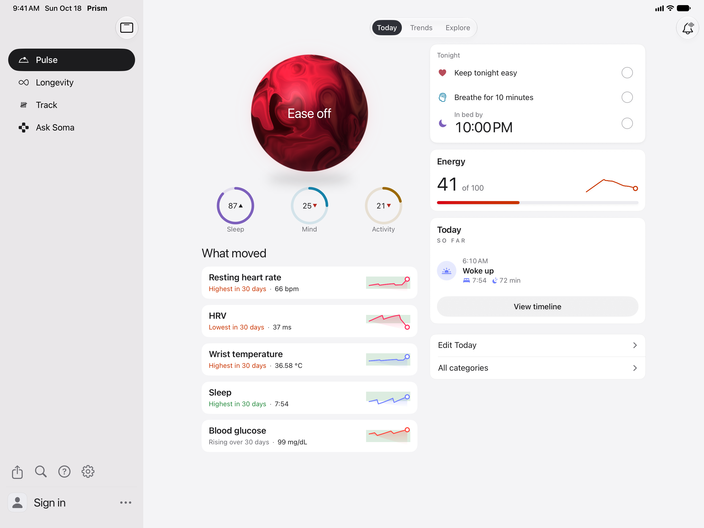

# Prism

The open source health app for iPhone, Mac and Vision Pro. By Soma.

Prism reads what Apple Health holds, including what the Oura, Whoop and Withings apps write there, and works out your sleep, recovery, strain, stress and energy scores on the device. It's free, there's no subscription and no ring required: it scores whatever your watch, ring or iPhone has recorded. You can use it without an account, your data stays on the device until you choose to sign in, and the code behind every score is in this repository.

[](LICENSE)
[](#build-it)
[](https://www.swift.org)

| Today | Longevity | Track | Ask | Tools | iPad |
|---|---|---|---|---|---|
|  |  |  |  |  |  |

Screenshots show simulated data.

## What it does

- **Today.** Your five daily scores (sleep, recovery, strain, stress and energy), with Trends over time and Explore, a library of health articles, most of them adapted from NIH.
- **Longevity.** Three lenses. Body covers cardio, strength, muscle work and body measurements. Mind covers mood, check-ins and breathing. Environment covers weather, air quality and daylight where you are.
- **Labs.** Add a blood test by photo, PDF or typed values. It's read on the device and you check every value before it's saved. From a panel, Prism gives informational estimates: biological age (Levine's PhenoAge) and cardiometabolic risk (the AHA PREVENT equations, Khan et al., Circulation 2024, with CKD-EPI 2021 eGFR).
- **Track.** A journal with daily check-ins, and rituals: a log of food, water, caffeine, supplements, fasting, mood and practices.
- **Ask.** Questions about your own numbers. With a cloud account, a language model answers. Without one, Ask answers its suggested questions from today's numbers on the phone.
- **Tools.** Fifteen small planners built on your data: Smart Alarm, Sleep Forecast, Nap Architect, Phase Alignment, Social Jetlag, Caffeine Window, Supplement Window, Evening Close, Travel, Shift Work Reset, Sun Budget, Skin Forecast, Aging Pace, Strength Load and Screening Ledger.
- **Vault.** Every Apple Health reading by type, with its records, source and quality.
- **Widgets.** Scores, strain, vitals, fuel and a quick log on the Home Screen, plus Control Center buttons that log water or coffee.

## How it compares

Checked on 2026-10-18. Every competitor cell is sourced in the [full comparison](docs/COMPARISON.md), which also lists what each app does better.

| | Prism | Apple Health | Oura app | Bevel |
|---|---|---|---|---|
| Price (USD) | Free | Free, built in | App free, membership $5.99 a month or $69.99 a year | Free tier, Pro $14.99 a month or $99.99 a year |
| Hardware required | None. Scores need data in Apple Health | None for the basic app. Apple Watch for sleep score, vitals and Training Load | An Oura Ring | None of its own |
| Open source | Yes, AGPL-3.0 | No | No | No |
| Account required | No | No | Yes | In practice yes |
| Data stays on device by default | Yes, until you sign in | Yes, with iCloud sync when iCloud is on | No, held on Oura servers | Apple Health data while Bevel Intelligence is off |
| Sleep, recovery, strain, stress, energy | All five | Sleep score with Apple Watch, Training Load, no stress or energy score | Sleep, Readiness, Activity, Daytime Stress | All five |
| Blood test import | Yes, read on the device | Health Records from some US providers | $99 Quest panel (US, members), PDF uploads rolling out | Pro only |
| AI assistant | Needs a cloud account, off in the build as shipped | No | Oura Advisor, in membership | Bevel Intelligence, Pro |
| Mac and Vision Pro | Both build, but Apple Health data there hasn't been checked by hand | No Mac app, Vision Pro for mindfulness only | Vision Pro listed, Mac not listed | Mac as an iPhone app only, Vision Pro not mentioned |
| Android or web | Web: no. Android: in development | No | Android, and a web app whose future is unconfirmed | No |
| Raw data export | ZIP of JSON and NDJSON | XML | CSV, by request | By email request |

Where Prism falls short: it has no sensor of its own, so its scores are only as good as what your devices write to Apple Health. It has no clinical validation, no Apple Watch app in this build, no web version, no Android release yet (an Android version is in development), and it's a new project without the years of feedback the others have.

## Your data

- **Local mode.** Tap "Not now" on the first onboarding screen. Your Health data, journal, logs, scores and lab results stay on the device. In the build as shipped, the only request carrying anything about you that goes to a service other than Apple's is the weather and air quality card: it sends a location rounded to 0.1 degree (about 11 km) to [Open-Meteo](https://open-meteo.com). Apple's MapKit gets the device location rounded to 0.01 degree (about 1 km) to name your place, and the middle of each group of this month's workout routes, rounded the same way, to name it on the Territory page. The city search goes to Apple, and maps load Apple Maps tiles.
- **Soma cloud.** `App/Config/Cloud.xcconfig` points at Soma's Supabase project and ships with an empty publishable key, so accounts, sync, Ask and the online article and news feed stay off until a key is set. With Soma's key set, the article and news feed are fetched anonymously, their cover images load straight from the publisher's host (the CDC's, as the feed list stands), and signing in with Apple syncs your records and Apple Health samples to Soma cloud. Ask sends your question and a short summary of your numbers to a language model. Sign in with Apple is the only sign in the app offers; email sign in is planned (see [ROADMAP.md](ROADMAP.md)).
- **Self hosting.** Run the backend in `supabase/` yourself and put its address and publishable key in `Cloud.xcconfig`. See [docs/SELF_HOSTING.md](docs/SELF_HOSTING.md).
- **Export.** Settings, Data, Export my data: one ZIP with a JSON file per record table and one NDJSON file per Apple Health metric.
- **Delete.** Settings, Data, Delete my data removes your account and everything stored with it online. Prism never deletes anything from Apple Health.

The details, request by request, are in [PRIVACY.md](PRIVACY.md).

## Build it

You need Xcode 27. The app targets iOS 27, iPadOS 27, macOS 27 and visionOS 27.

```bash
git clone https://github.com/soma-intelligence/prism.git
cd prism && open App/Prism.xcodeproj
```

Then run the `Prism` scheme on an iOS or visionOS simulator. That needs no account, no team and no setup. HealthKit has no data in the simulator, so values show as a dash there; real numbers need a device.

To run on a Mac or on a device, Xcode needs a team to sign with. Copy `App/Config/Signing.example.xcconfig` to `App/Config/Signing.xcconfig` (git ignored) and set two values: `PRISM_DEVELOPMENT_TEAM`, your ten character team id, and `PRISM_BUNDLE_ID`, an id that's unique to you, such as `com.yourname.Prism`. A free Personal Team should be enough to run on your own device, but the maintainers haven't tried it. HealthKit on a Mac needs its capability on your team and app id too. Change the app group `group.Soma.Prism` as well, in `App/Prism.entitlements`, `App/SomaWidgets/SomaWidgets.entitlements` and `SnapshotStore.appGroup` in `App/SomaWidgetKit`, before you run on a Mac or a device: automatic signing under another team can't register Soma's group.

To only check that the code compiles from the command line, on any platform, add `CODE_SIGNING_ALLOWED=NO` to the `xcodebuild` command. Without it, a Mac build stops on a missing development certificate and a visionOS device build asks for a team. The simulators don't need the flag.

The tests, the design rules and the package layout are in [CONTRIBUTING.md](CONTRIBUTING.md) and [docs/ARCHITECTURE.md](docs/ARCHITECTURE.md).

## Roadmap

Direct Oura, Whoop and Withings connections are written and switched off in this build. They're coming, along with restoring your journal and logs on a new phone. See [ROADMAP.md](ROADMAP.md).

## Contributing

Issues and pull requests are welcome. Read [CONTRIBUTING.md](CONTRIBUTING.md) first, and report security problems privately as [SECURITY.md](SECURITY.md) describes.

## License and trademarks

Prism is copyright Soma Labs, Inc. and licensed under the [GNU Affero General Public License v3.0](LICENSE). Third party material and its licenses are listed in [NOTICE.md](NOTICE.md). The Soma name, the Soma mark and the app icons are trademarks of Soma Labs, Inc. and aren't covered by the code license: a fork you distribute needs its own name, icons and bundle id. See [TRADEMARKS.md](TRADEMARKS.md).

## Wellness, not medicine

Prism is a wellness app. Its scores and estimates are for following your own trends. They aren't medical advice and Prism doesn't diagnose, treat or prevent any condition. Talk to a clinician about your health.
