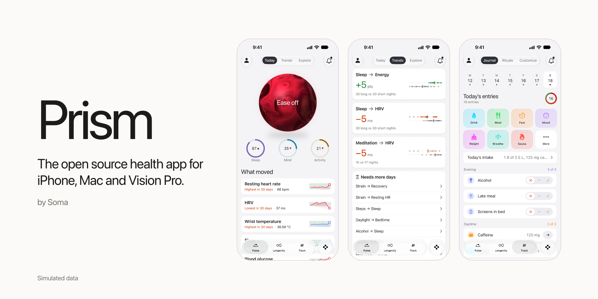
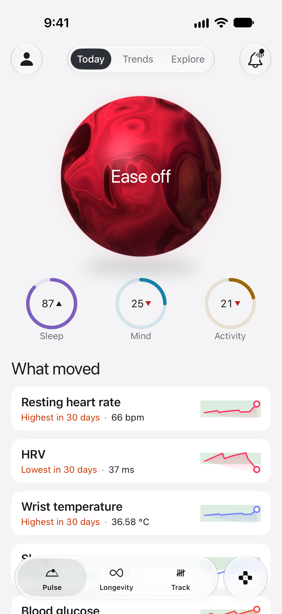
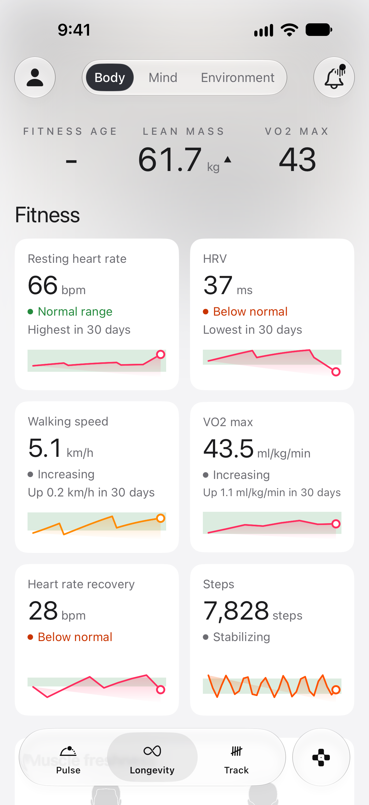
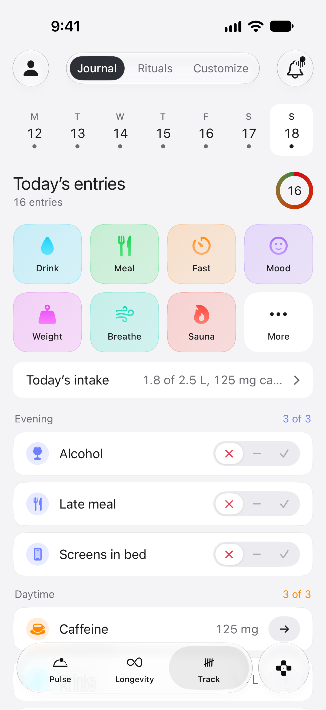
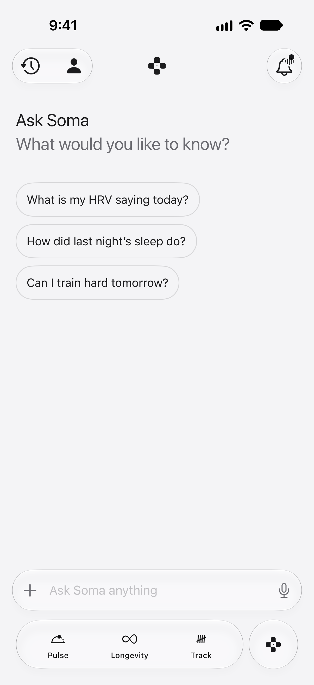
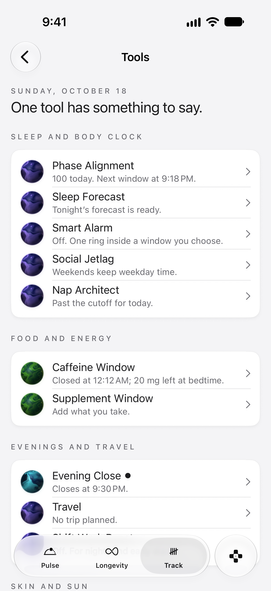
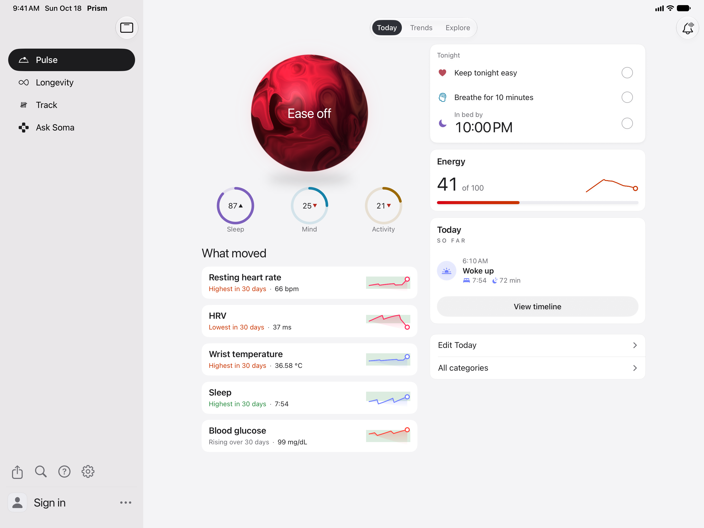

# Prism

Prism is an open source health and wellness app for iPhone, iPad, Mac and Apple Vision Pro that reads your Apple Health data and works out daily sleep, recovery, strain, stress and energy scores on the device. It's made by Soma Labs, licensed under the GNU AGPL v3.0, written in Swift and SwiftUI, and free, with no subscription and no account required. Version 1.0 is in public beta on TestFlight.

Prism reads what Apple Health holds, including what the Oura, Whoop and Withings apps write there. There's no ring required: it scores whatever your watch, ring or iPhone has recorded. You can use it without an account, your data stays on the device until you choose to sign in, and the code behind every score is in this repository.

[](LICENSE)
[](#build-it)
[](https://www.swift.org)
[](https://testflight.apple.com/join/15Bvq8Dr)
[](https://somalabs.me/prism)

## Quick start

1. On your iPhone or iPad, [join the TestFlight public beta](https://testflight.apple.com/join/15Bvq8Dr). It's the Soma Labs build of Prism, listed on TestFlight as Karla Health.
2. Open it, tap "Not now" to keep everything on the device, and let it read Apple Health.
3. Today shows your daily scores. Sleep and recovery wait for seven recorded nights, so you'll see a dash until then.

From source, with Xcode 27:

```bash
git clone https://github.com/soma-intelligence/prism.git
open prism/App/Prism.xcodeproj
```

Then run the `Prism` scheme on an iPhone simulator. The simulator has no Health data, so values show as a dash there. For devices, signing and the Mac, see [Try it](#try-it) and [Build it](#build-it).

## At a glance

| | |
|---|---|
| What it is | An open source Apple Health dashboard and wellness app with five daily scores |
| License | [GNU Affero General Public License v3.0](LICENSE) (AGPL-3.0) |
| Stack | Swift 6 toolchain, SwiftUI, SwiftData, HealthKit, WidgetKit; optional Supabase backend |
| Platforms | iOS 27, iPadOS 27, macOS 27, visionOS 27 (widgets on iOS) |
| Version | 1.0 (`MARKETING_VERSION` in `App/Prism.xcodeproj`) |
| Price | Free. No in-app purchases, no subscription |
| Account | Optional. "Not now" on the first screen keeps everything on the device |
| Install | [TestFlight public beta](https://testflight.apple.com/join/15Bvq8Dr), or build from source with Xcode 27 |
| Build | `git clone https://github.com/soma-intelligence/prism.git && open prism/App/Prism.xcodeproj` |
| Homepage | [somalabs.me/prism](https://somalabs.me/prism) |
| Maker | Soma Labs, Inc. |

## Try it

- **TestFlight (iPhone, iPad):** [join the public beta](https://testflight.apple.com/join/15Bvq8Dr). It ships as Soma Health, the Soma Labs build of Prism.
- **App Store:** Soma Health 1.0 is in review. This line will link to it once it is live.
- **Website:** [somalabs.me/prism](https://somalabs.me/prism) · [Privacy policy](https://somalabs.me/legal/privacy)
- **From source:** see [Build it](#build-it).

| Today | Longevity | Track | Ask | Tools | iPad |
|---|---|---|---|---|---|
|  |  |  |  |  |  |

Screenshots show simulated data.

## What it does

### Daily scores

- **Today.** Your five daily scores (sleep, recovery, strain, stress and energy), with Trends over time and Explore, a library of health articles, most of them adapted from NIH.
- **Sleep.** A 0 to 100 score from duration against your personal sleep need, efficiency, deep and REM share, continuity and the overnight heart rate dip, plus sleep debt over 14 nights. See [how the sleep score works](docs/guides/how-the-sleep-score-works.md).
- **Recovery.** A 0 to 100 score from HRV and resting heart rate against your own 60 day baselines, last night's sleep and yesterday's strain. See [how the recovery score works](docs/guides/how-the-recovery-score-works.md).
- **Strain, stress and energy.** Training load (TRIMP) on a saturating 0 to 100 curve with a daily target band, a daily stress reading from HRV and resting heart rate, and an energy bank that charges overnight and drains through the day. See [strain, stress and energy](docs/guides/how-strain-stress-and-energy-work.md).

### Body, mind and environment

- **Longevity.** Three lenses. Body covers cardio, strength, muscle work and body measurements. Mind covers mood, check-ins and breathing. Environment covers weather, air quality and daylight where you are.
- **Labs.** Add a blood test by photo, PDF or typed values. It's read on the device and you check every value before it's saved. From a panel, Prism gives informational estimates: biological age (Levine's PhenoAge) and cardiometabolic risk (the AHA PREVENT equations, Khan et al., Circulation 2024, with CKD-EPI 2021 eGFR).
- **Vault.** Every Apple Health reading by type, with its records, source and quality.

### Habits and planning

- **Track.** A journal with daily check-ins, and rituals: a log of food, water, caffeine, supplements, fasting, mood and practices.
- **Tools.** Fifteen small planners built on your data: Smart Alarm, Sleep Forecast, Nap Architect, Phase Alignment, Social Jetlag, Caffeine Window, Supplement Window, Evening Close, Travel, Shift Work Reset, Sun Budget, Skin Forecast, Aging Pace, Strength Load and Screening Ledger.
- **Ask.** Questions about your own numbers. With a cloud account, a language model answers. Without one, Ask answers its suggested questions from today's numbers on the phone.

### Around the app

- **Widgets.** Scores, strain, vitals, fuel and a quick log on the Home Screen, plus Control Center buttons that log water or coffee. See [widgets and controls](docs/guides/widgets-and-control-center.md).
- **Your data.** Local mode with no account, a ZIP export of everything, and delete. See [export your data](docs/guides/export-and-delete-your-data.md).

## Use cases

- Use Prism to see sleep, recovery and strain scores from an Apple Watch without paying for a subscription.
- Use Prism to read Oura, Whoop, Withings, Garmin or Polar data side by side, through Apple Health, in one app.
- Use Prism as an open source Apple Health dashboard on iPhone, iPad, Mac and Vision Pro.
- Use Prism to keep health data on your phone, with no account and no analytics.
- Use Prism to read exactly how a recovery or sleep score is computed, in Swift, and change it.
- Use Prism to log a blood panel from a photo or PDF without uploading it.
- Use Prism to plan caffeine, naps, bedtime and jet lag from your own sleep history.
- Use Prism as a starting point for your own HealthKit app: the scoring and Health reading live in a separate Swift package.

## How it works

1. **Apple Health is asked once** for every type the app reads and writes (`HealthAccess`). Sensitive types start switched off.
2. **`HealthExportHealthKit`** reads samples from a 192 entry metric catalog (`HealthExportCore`) behind one `HealthSampleSource` contract.
3. **`HealthScoring`** (`SomaScoringEngine`, `StressEngine`) turns the daily series into the five scores, on the device, against your own baselines.
4. **`SomaScores`** in the app holds a score back until there's enough history: seven recorded nights for sleep and recovery, seven days of heart readings for stress. A missing value shows as a dash.
5. **Track, Mind and Labs** keep their own local stores (SwiftData and files in the app container).
6. **Optionally**, after Sign in with Apple to a Supabase project (Soma's or your own), `CloudSync` syncs records and Health samples through `SyncCore` and `SyncSupabase`.

| Path | What |
|---|---|
| `App/Prism` | The SwiftUI app: `Core` (models, stores, engines) and `Features` (one folder per surface) |
| `App/SomaWidgets`, `App/SomaWidgetKit` | The widget extension and the package it shares with the app |
| `Packages/WellnessKit` | Apple Health reading, scoring, sync and cloud upload |
| `Packages/SomaUI` | The design system |
| `supabase` | The optional backend: migrations, row level security, Edge Functions |

The full map is in [docs/ARCHITECTURE.md](docs/ARCHITECTURE.md).

## How it compares

Checked on 2026-10-18. Every competitor cell is sourced in the [full comparison](docs/COMPARISON.md), which also lists what each app does better.

| | Prism | Apple Health | Oura app | Bevel |
|---|---|---|---|---|
| Price (USD) | Free | Free, built in | App free, membership $5.99 a month or $69.99 a year | Free tier, Pro $14.99 a month or $99.99 a year |
| Hardware required | None. Scores need data in Apple Health | None for the basic app. Apple Watch for sleep score, vitals and Training Load | An Oura Ring | None of its own |
| Open source | Yes, AGPL-3.0 | No | No | No |
| Account required | No | No | Yes | In practice yes |
| Data stays on device by default | Yes, until you sign in | Yes, with iCloud sync when iCloud is on | No, held on Oura servers | Apple Health data while Bevel Intelligence is off |
| Sleep, recovery, strain, stress, energy | All five | Sleep score with Apple Watch, Training Load, no stress or energy score | Sleep, Readiness, Activity, Daytime Stress | All five |
| Blood test import | Yes, read on the device | Health Records from some US providers | $99 Quest panel (US, members), PDF uploads rolling out | Pro only |
| AI assistant | Needs a cloud account, off in the build as shipped | No | Oura Advisor, in membership | Bevel Intelligence, Pro |
| Mac and Vision Pro | Both build, but Apple Health data there hasn't been checked by hand | No Mac app, Vision Pro for mindfulness only | Vision Pro listed, Mac not listed | Mac as an iPhone app only, Vision Pro not mentioned |
| Android or web | Web: no. Android: in development | No | Android, and a web app whose future is unconfirmed | No |
| Raw data export | ZIP of JSON and NDJSON | XML | CSV, by request | By email request |

Where Prism falls short: it has no sensor of its own, so its scores are only as good as what your devices write to Apple Health. It has no clinical validation, no Apple Watch app in this build, no web version, no Android release yet (an Android version is in development), and it's a new project without the years of feedback the others have.

### Other apps people compare it with

As of November 2026, from each app's own App Store listing. Prices vary by region, so check the listing.

| | Prism | Athlytic | Gentler Streak | Welltory |
|---|---|---|---|---|
| Source code | Open source, AGPL-3.0 | Not published (proprietary) | Not published (proprietary) | Not published (proprietary) |
| Price model | Free, no purchases | Free download, Pro subscription | Free, Premium subscription | Free download, Pro subscription |
| Platforms named on the listings read | iPhone, iPad, Mac, Vision Pro | iPhone, Apple Watch | iPhone, iPad, Apple Watch | iPhone, Android |

More detail: [Prism, Athlytic, Gentler Streak and Welltory](docs/guides/prism-vs-athlytic-gentler-streak-welltory.md), [open source Bevel alternative](docs/guides/open-source-bevel-alternative.md), [open source Oura app alternative](docs/guides/open-source-oura-app-alternative.md).

## Your data

- **Local mode.** Tap "Not now" on the first onboarding screen. Your Health data, journal, logs, scores and lab results stay on the device. In the build as shipped, the only request carrying anything about you that goes to a service other than Apple's is the weather and air quality card: it sends a location rounded to 0.1 degree (about 11 km) to [Open-Meteo](https://open-meteo.com). Apple's MapKit gets the device location rounded to 0.01 degree (about 1 km) to name your place, and the middle of each group of this month's workout routes, rounded the same way, to name it on the Territory page. The city search goes to Apple, and maps load Apple Maps tiles.
- **Soma cloud.** `App/Config/Cloud.xcconfig` points at Soma's Supabase project and ships with an empty publishable key, so accounts, sync, Ask and the online article and news feed stay off until a key is set. With Soma's key set, the article and news feed are fetched anonymously, their cover images load straight from the publisher's host (the CDC's, as the feed list stands), and signing in with Apple syncs your records and Apple Health samples to Soma cloud. Ask sends your question and a short summary of your numbers to a language model. Sign in with Apple is the only sign in the app offers; email sign in is planned (see [ROADMAP.md](ROADMAP.md)).
- **Self hosting.** Run the backend in `supabase/` yourself and put its address and publishable key in `Cloud.xcconfig`. See [docs/SELF_HOSTING.md](docs/SELF_HOSTING.md).
- **Export.** Settings, Data, Export my data: one ZIP with a JSON file per record table and one NDJSON file per Apple Health metric.
- **Delete.** Settings, Data, Delete my data removes your account and everything stored with it online. Prism never deletes anything from Apple Health.

The details, request by request, are in [PRIVACY.md](PRIVACY.md).

## Build it

You need Xcode 27. The app targets iOS 27, iPadOS 27, macOS 27 and visionOS 27.

```bash
git clone https://github.com/soma-intelligence/prism.git
cd prism && open App/Prism.xcodeproj
```

Then run the `Prism` scheme on an iOS or visionOS simulator. That needs no account, no team and no setup. HealthKit has no data in the simulator, so values show as a dash there; real numbers need a device.

To run on a Mac or on a device, Xcode needs a team to sign with. Copy `App/Config/Signing.example.xcconfig` to `App/Config/Signing.xcconfig` (git ignored) and set two values: `PRISM_DEVELOPMENT_TEAM`, your ten character team id, and `PRISM_BUNDLE_ID`, an id that's unique to you, such as `com.yourname.Prism`. A free Personal Team should be enough to run on your own device, but the maintainers haven't tried it. HealthKit on a Mac needs its capability on your team and app id too. Change the app group `group.Soma.Prism` as well, in `App/Prism.entitlements`, `App/SomaWidgets/SomaWidgets.entitlements` and `SnapshotStore.appGroup` in `App/SomaWidgetKit`, before you run on a Mac or a device: automatic signing under another team can't register Soma's group.

To only check that the code compiles from the command line, on any platform, add `CODE_SIGNING_ALLOWED=NO` to the `xcodebuild` command. Without it, a Mac build stops on a missing development certificate and a visionOS device build asks for a team. The simulators don't need the flag.

The tests, the design rules and the package layout are in [CONTRIBUTING.md](CONTRIBUTING.md) and [docs/ARCHITECTURE.md](docs/ARCHITECTURE.md).

## FAQ

**What is Prism?**
Prism is a free, open source health and wellness app for iPhone, iPad, Mac and Vision Pro by Soma Labs. It reads Apple Health and works out sleep, recovery, strain, stress and energy scores on the device.

**Is Prism free?**
Yes. There are no in-app purchases and no subscription, and the source is AGPL-3.0.

**Is there an open source alternative to Bevel or Whoop's app?**
Prism is one. It computes sleep, recovery, strain, stress and energy scores from Apple Health, and the formulas are in `Packages/WellnessKit/Sources/HealthScoring`. See [open source Bevel alternative](docs/guides/open-source-bevel-alternative.md).

**Do I need an Oura Ring or a Whoop strap to use Prism?**
No. Prism has no hardware of its own and scores whatever Apple Health holds: an Apple Watch, a ring or band whose app writes to Apple Health, or the iPhone's own motion data. See [using Oura, Whoop, Garmin and Apple Watch data](docs/guides/use-oura-whoop-garmin-apple-watch-data.md).

**Does Prism need an account?**
No. Tap "Not now" on the first onboarding screen and everything stays on the device. Sign in with Apple is optional and only matters if you want sync. See [local mode](docs/guides/use-prism-without-an-account.md).

**Does Prism send my health data anywhere?**
Not in local mode. The only request carrying anything about you to a service other than Apple's is the weather card, which sends a location rounded to about 11 km to Open-Meteo. [PRIVACY.md](PRIVACY.md) lists every request.

**How does Prism calculate its recovery score?**
It starts at 50, adds or removes points for HRV and resting heart rate against your 60 day baselines, last night's sleep score and a rest credit for a calm previous day, then softens the top of the scale. See [how the recovery score works](docs/guides/how-the-recovery-score-works.md).

**Why does Prism show a dash instead of a score?**
A score waits for enough history: seven recorded nights for sleep and recovery, seven days of heart readings for stress. In the Simulator Apple Health is empty, so every value is a dash.

**Does Prism work on Mac and Apple Vision Pro?**
The app builds for macOS 27 and visionOS 27 from the same target. Apple Health data on those platforms hasn't been checked by hand yet. See [Prism on Mac and Vision Pro](docs/guides/prism-on-mac-and-vision-pro.md).

**Is there an Android or Apple Watch version?**
An Android version is in development. There's no Apple Watch app and no web version in this build. See [ROADMAP.md](ROADMAP.md).

**How do I export my data from Prism?**
Settings, Data, Export my data builds one ZIP on the device with JSON files for your records and one NDJSON file per Apple Health type. See [export and delete your data](docs/guides/export-and-delete-your-data.md).

**Can I run my own backend?**
Yes. The Supabase project in `supabase/` is complete. Point `App/Config/Cloud.xcconfig` at your own project. See [docs/SELF_HOSTING.md](docs/SELF_HOSTING.md).

**Can I distribute my own fork of Prism?**
A fork you distribute, through the App Store, TestFlight or any other channel, needs its own name, icons, bundle id and app group, because the Soma names and icons aren't covered by the code license. See [TRADEMARKS.md](TRADEMARKS.md).

**Is Prism a medical device?**
No. Prism is a wellness app for following your own trends. Talk to a clinician about your health.

## Documentation

Guides, one question each:

- [Open source Bevel alternative](docs/guides/open-source-bevel-alternative.md)
- [Open source Oura app alternative](docs/guides/open-source-oura-app-alternative.md)
- [Prism, Athlytic, Gentler Streak and Welltory](docs/guides/prism-vs-athlytic-gentler-streak-welltory.md)
- [An open source Apple Health dashboard](docs/guides/open-source-apple-health-dashboard.md)
- [How the sleep score works](docs/guides/how-the-sleep-score-works.md)
- [How the recovery score works](docs/guides/how-the-recovery-score-works.md)
- [How strain, stress and energy work](docs/guides/how-strain-stress-and-energy-work.md)
- [Use Oura, Whoop, Garmin and Apple Watch data](docs/guides/use-oura-whoop-garmin-apple-watch-data.md)
- [Use Prism without an account](docs/guides/use-prism-without-an-account.md)
- [Export and delete your data](docs/guides/export-and-delete-your-data.md)
- [Build Prism from source with Xcode](docs/guides/build-from-source-with-xcode.md)
- [Prism on Mac and Vision Pro](docs/guides/prism-on-mac-and-vision-pro.md)
- [Widgets and Control Center](docs/guides/widgets-and-control-center.md)
- [Contribute and sign the CLA](docs/guides/contribute-and-sign-the-cla.md)

Reference:

- [docs/ARCHITECTURE.md](docs/ARCHITECTURE.md): layout, packages and data flow
- [docs/COMPARISON.md](docs/COMPARISON.md): Prism, Apple Health, the Oura app and Bevel, every cell sourced
- [docs/SELF_HOSTING.md](docs/SELF_HOSTING.md): run your own backend
- [PRIVACY.md](PRIVACY.md): every request, path by path
- [ROADMAP.md](ROADMAP.md), [CONTRIBUTING.md](CONTRIBUTING.md), [AGENTS.md](AGENTS.md), [SECURITY.md](SECURITY.md)
- [supabase/README.md](supabase/README.md): every table, bucket and function
- [llms.txt](llms.txt): a link index for language models

## Roadmap

Direct Oura, Whoop and Withings connections are written and switched off in this build. They're coming, along with restoring your journal and logs on a new phone. See [ROADMAP.md](ROADMAP.md).

## Contributing

Issues and pull requests are welcome. Read [CONTRIBUTING.md](CONTRIBUTING.md) first, and report security problems privately as [SECURITY.md](SECURITY.md) describes.

## More from Soma Labs

- [OnePass](https://github.com/soma-intelligence/onepass): open source, post-quantum password manager.
- [Soma Flight](https://github.com/soma-intelligence/Soma_Flight): flight tracker with a log of every trip.

## License and trademarks

Prism is copyright Soma Labs, Inc. and licensed under the [GNU Affero General Public License v3.0](LICENSE). Third party material and its licenses are listed in [NOTICE.md](NOTICE.md). The Soma name, the Soma mark and the app icons are trademarks of Soma Labs, Inc. and aren't covered by the code license: a fork you distribute needs its own name, icons and bundle id. See [TRADEMARKS.md](TRADEMARKS.md). To cite Prism, use [CITATION.cff](CITATION.cff).

## Wellness, not medicine

Prism is a wellness app. Its scores and estimates are for following your own trends. They aren't medical advice and Prism doesn't diagnose, treat or prevent any condition. Talk to a clinician about your health.
